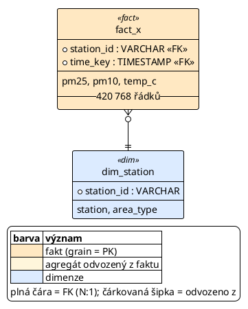

# Docs and diagrams

The user's docs are in Czech and short. Match the existing files: read the multi-senger parts of
`docs/data.md` and `docs/decisions.md` before writing, and copy their structure and tone. Facts
in the docs must come from queries you ran (row counts, coverage), not from expectations.

## docs/data.md

New pack: append a section `## Schéma packu \`<pack>\`` (plus `## Zdroje` for sources if the pack
brings new ones). Extension: add rows to the existing tables of that pack's section.

```markdown
## Zdroje packu `<pack>`

| Fakt / dimenze | Zdroj | Odkaz | Grain | Stav |
|---|---|---|---|---|
| `fact_x` | <source, licence> | [link](<url>) | <grain in words> | ✅ staženo (<what, period>) |

## Schéma packu `<pack>` (<star schema | fact constellation>)

Build: `DATASET=<pack> uv run python scripts/build_db.py` (<build time>). Kód je v `datasets/<pack>/build.sql`.
Sekce 99 build zastaví, když nesedí grain nebo cizí klíč. Časy jsou v <UTC / zone>.

### Fakty a agregáty

| Tabulka | Grain (1 řádek =) | Řádků | Míry / sloupce |
|---|---|---|---|
| `fact_x` | stanice × hodina | 420 768 | `pm25`, `temp_c`, ... |

### Dimenze

| Tabulka | Řádků | Hierarchie / sloupce |
|---|---|---|

### Propojení faktů (jen přes sdílené dimenze)

| Dvojice | Společný grain | Poznámka |
|---|---|---|
```

Known problems of the data go to `## Známé problémy` as bullets (`- **<pack>:** ...`).
Numbers use a space as thousands separator and a decimal comma (`420 768`, `0,94 GB`).

## docs/decisions.md

One dated entry per session that decided something, numbered, newest at the bottom:

```markdown
## 2026-10-30 – pack `<pack>`

1. **<Decision as one bold sentence.>** <Why, in one or two sentences.>
   - <evidence with numbers: "15,6 % hodin má méně než 60 minut">
   - <the alternative that was rejected and why>
2. **...**
```

Record the decisions the user made at the checkpoints (with their reason), data fixes in
build.sql with the evidence, and anything that changes how the data may be used (grain, time zone,
exclusions, additivity choices that are not obvious).

## PlantUML diagrams

Two diagrams per pack, modelled on `docs/multi-senger_schema.puml` and
`docs/multi-senger_joins.puml` (open them and copy their header, colours and legend):

- `docs/<pack>_schema.puml`: every table as an `entity` with its stereotype and colour (`FACT`,
  `AGG`, `DIM`, `BRIDGE`), the grain columns marked `*` above `--`, measures below, row count as
  `__N řádků__`; relationships with crow's-foot edges (`fact }o--|| dim`), roll-ups labelled
  `roll-up`, derivations as dotted arrows (`..>`). Packages group the core facts, shared dimensions
  and context sources.
- `docs/<pack>_joins.puml`: only facts and aggregates as classes with their grain in words; plain
  lines for joins through shared dimensions (label: keys + rule id), red bold lines for ASOF-only
  pairs (`-[#C0392B,bold]-`), dotted arrows for derivations, a legend.

Minimal schema skeleton:



Render both to SVG and PNG (the repo keeps both next to the .puml). PlantUML is not on PATH; find
the jar first:

```bash
JAR=$(find ~ -name 'plantuml*.jar' 2>/dev/null | head -1)   # e.g. the VS Code extension's copy
java -jar "$JAR" -tsvg docs/<pack>_schema.puml docs/<pack>_joins.puml
java -jar "$JAR" -tpng docs/<pack>_schema.puml docs/<pack>_joins.puml
```

If no jar is found, leave the .puml files and tell the user how to render them. Look at the PNG
(Read tool) after rendering: overlapping edges and unreadable labels are common; fix the layout
with edge directions (`-left-`, `-right-`) and package grouping.
